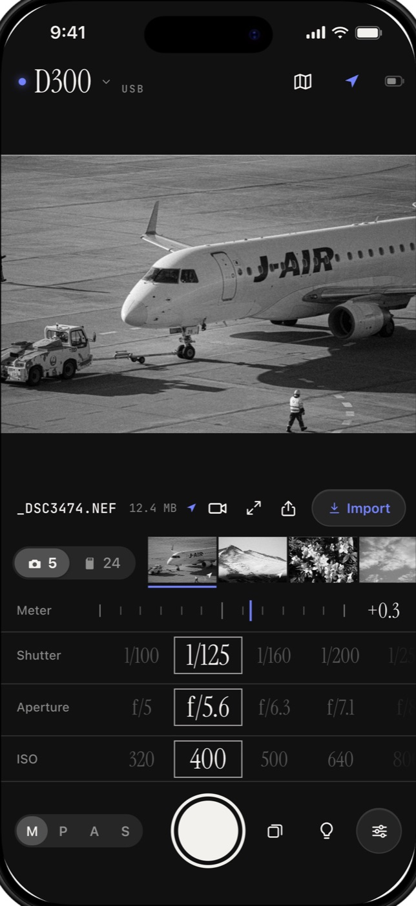
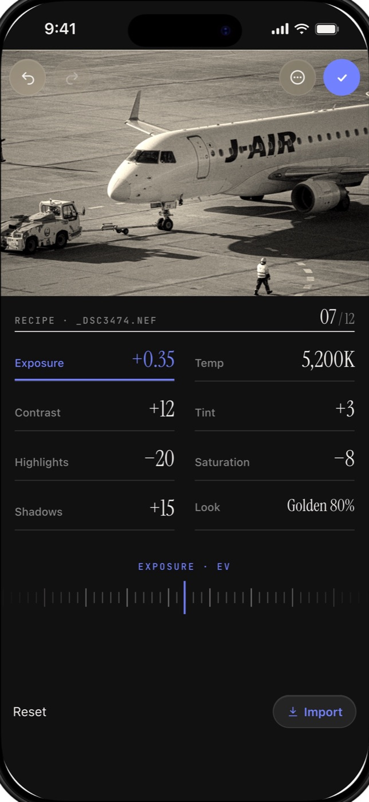
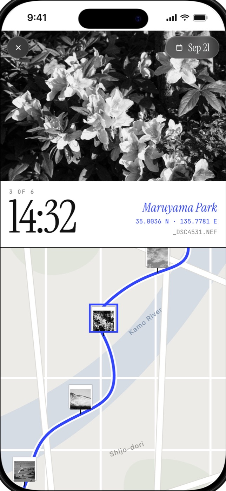
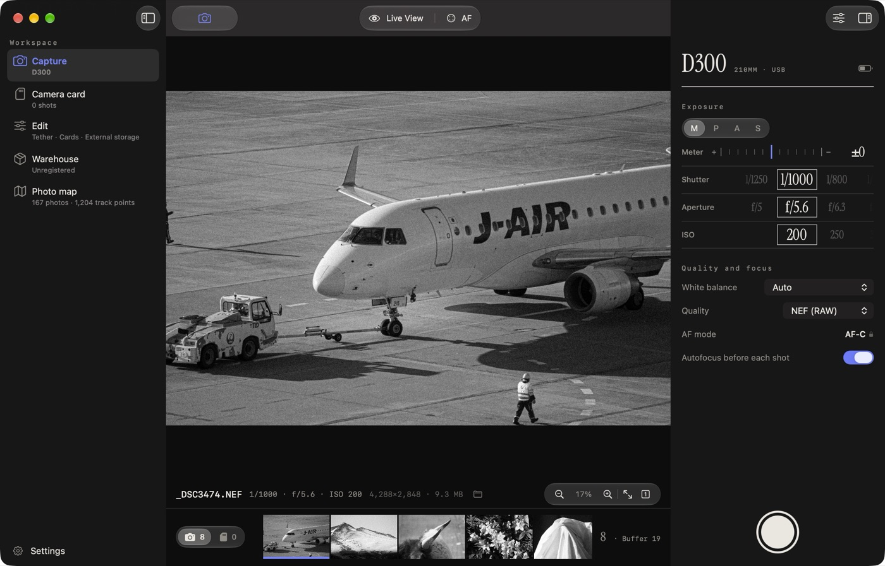
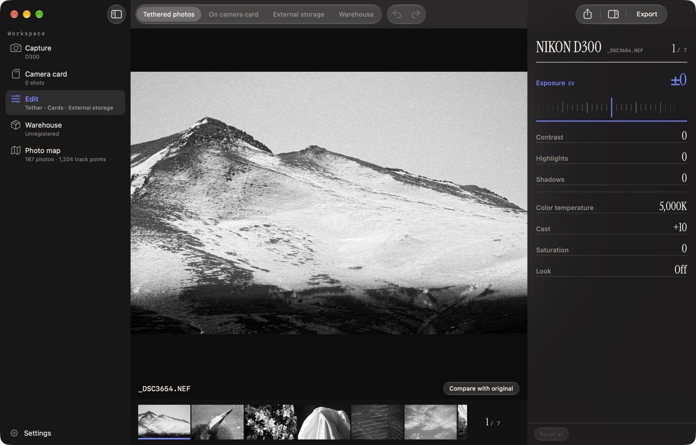

# Tethr

**カメラ、写真、ストレージを、ひとつの仕組みで。**
iPhone と Mac のための、テザー撮影・取り込み・編集・写真の管理。

[English](README.md) · サイト: [tethr.pages.dev](https://tethr.pages.dev) · [これから](ROADMAP.ja.md)

> Tethr の公開の概要です。コードそのものは非公開のリポジトリにあります。
> ここには、Tethr が何か・今どこまでできているか・これから何をするか・どれくらいの大きさか、を置いています。
> 非公開のリポジトリを見ながら手で更新し、数字はスクリプトで数えています。

---

## 3 つのアプリ

共通の Swift の部品の上に、アプリが 3 つあります。

| | アプリ | 何をするか |
|---|---|---|
| iPhone | **Tethr** | カメラをつなぎ、撮った一枚をその場で見て、選び、RAW を現像して、写真アプリに入れる。iPhone が撮った場所を記録するので、GPS の無いカメラでも位置の入った写真が残る。 |
| iPhone | **Tethr Keep** | 写真アプリの空きを作る。原本は自分のドライブへ。読み戻して中身が一致すると確かめてから、写真アプリには軽い版を残す。原本はワンタップで戻る。 |
| Mac | **Tethr for Mac** | ライブビューを見ながら撮る。カードから取り込む。iPhone の位置の記録を RAW に書き込む。どの写真がどこにいくつあるかを、ドライブや端末をまたいで覚えておく。 |

わざと入れないもの: アカウント・解析・広告。台帳は、あなたの端末とあなたの iCloud にだけ置きます。

## 今の状態 — 2026-11-19

| | |
|---|---|
| **Tethr for Mac** | 1.1 を公開中（Apple の公証済み。サイトからダウンロードできる）。1.1 は撮影と取り込みまで。台帳と写真の管理は開発版で動いていて、1.1 には入っていない。 |
| **Tethr（iPhone）** | TestFlight で試している。最後に上げたビルドは 2026-09-15。1.0 を仕上げているところで、App Store にはまだ出していない。 |
| **Tethr Keep** | 2026-11-19 に独立したアプリになった。同じ日に実機で初めて動かし、52 GB の写真ライブラリを約 45 秒で調べて、年ごとの大きさを出した。未公開。 |
| **カメラ** | Nikon D300: 最初から最後まで確認済み。Canon EOS 8000D: ドライバを書いて実機で確かめた。次はアプリの中での再テスト。ほかの PTP 対応カメラも、一覧・プレビュー・取り込みは動く見込み。遠隔操作はメーカー独自の命令に頼るので、機種による。 |

## 画面

| | | |
|---|---|---|
|  |  |  |
| 撮る | RAW を現像する | 撮った場所 |




## 数字

<!-- stats:start -->
非公開のリポジトリから 2026-11-19 に数えた。

| | |
|---|---|
| 開発の始まり | 2026-09-12（69 日） |
| コミット | 全ブランチで 507、`main` に 426。コミットした日は 32 日 ¹ |
| Swift | 393 ファイル・117,680 行（テストを含む） |
| 共通部分 | 57,880 行 |
| Mac アプリ | 25,000 行 |
| iPhone: Tethr | 21,598 行 |
| iPhone: Tethr Keep | 9,239 行 |
| 実機調査アプリ | 3,928 行 |
| テスト | 826 件を実行・合格 822・スキップ 4・失敗 0（共通 792・Mac 34） ² |

¹ コーディング用のツールが自動で作る途中保存のコミット 3,151 件は数えていない。
² 共通部分と Mac アプリで `swift test`（2026-11-19）。iPhone の 2 つのアプリには、まだ自分の単体テストが無い（中身の多くは共通部分にある）。

### 週ごとのコミット

全ブランチ。途中保存は除く。

```
2026-W37  █ 7
2026-W38  ████████████ 92
2026-W39  █████ 36
2026-W40  ████████████████████████████ 216
2026-W41  ████ 29
2026-W42  █ 2
2026-W43  ██████ 44
2026-W44  · 0
2026-W45  · 0
2026-W46  ██ 14
2026-W47  █████████ 67  （今週）
```
<!-- stats:end -->

## 仕組み

- [機種ごとの運転ルール](how/camera-rules.ja.md)
- [写真を失わずに空きを作る](how/keep-freeing-space.ja.md)
- [Studio Network — Mac がネットワークになる](how/studio-network.ja.md)

ほかの説明も、公開してよいと決めたものから [`how/`](how/) に足していきます。

## コードを公開しない理由

カメラとのやり取りと、写真を預かる仕組みが、製品そのものだからです。
このリポジトリは、作業が実在して進んでいることを示すためのもので、作ったものそのものは渡しません。

## 連絡先

[tethr.pages.dev/support](https://tethr.pages.dev/support)
