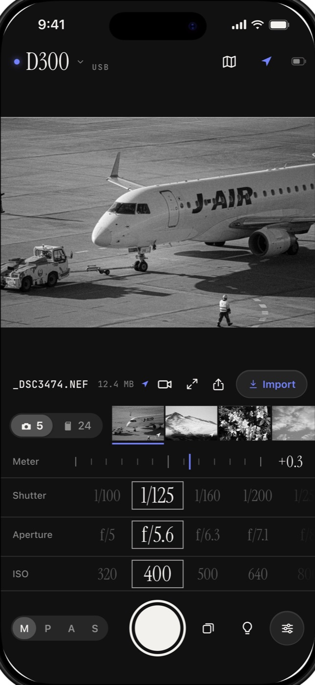
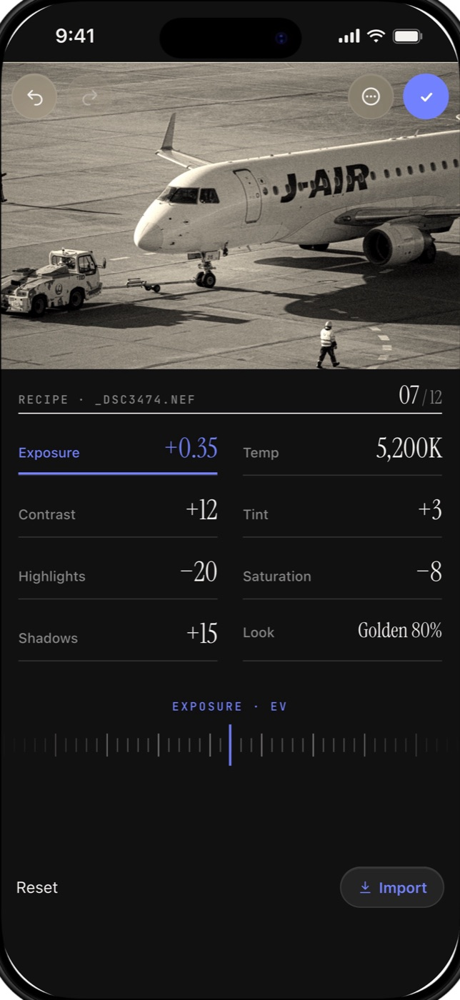
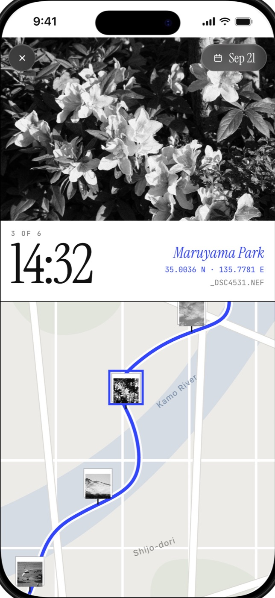
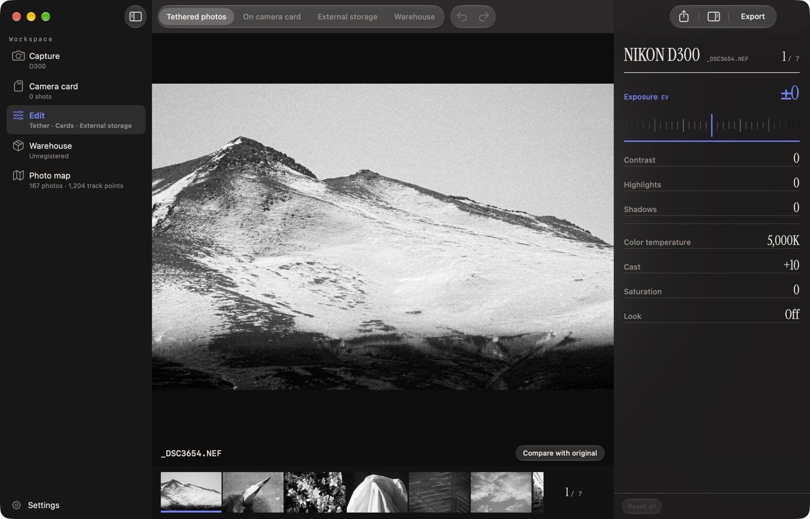

# Tethr

**Cameras, photos and storage, handled as one system.**
Tethered shooting, import, editing and photo management for iPhone and Mac.

[日本語](README.ja.md) · Site: [tethr.pages.dev](https://tethr.pages.dev) · [Roadmap](ROADMAP.md)

> This is the public overview of Tethr. The code itself lives in a private repository.
> This repository is for what Tethr is, where it stands today, where it is going, and how large it is.
> It is updated by hand from the private repository, and the numbers come from a script that counts them.

---

## The system

Three apps on one shared Swift core.

| | App | What it is for |
|---|---|---|
| iPhone | **Tethr** | Connect a camera, see each frame the moment it is taken, choose, develop the RAW, and put it into Photos. The iPhone records where you stood, so cameras without GPS still produce geotagged photographs. |
| iPhone | **Tethr Keep** | Make room in the Photos library. Originals go to a drive you own, and are read back and compared byte for byte; only then does Photos keep a lighter copy. One tap brings the original back. |
| Mac | **Tethr for Mac** | Shoot against a live view, import from the card, write the iPhone's location track into RAW files, and keep a catalog of which photo is where, and in how many copies, across drives and devices. |

What stays out on purpose: no accounts, no analytics, no advertising. The catalog lives on your own devices and in your own iCloud.

## Where it stands — 2026-11-19

| | |
|---|---|
| **Tethr for Mac** | Version 1.1 is public: notarised by Apple and downloadable from the site. It covers shooting and import. The catalog and photo management are working in development builds and are not in 1.1. |
| **Tethr (iPhone)** | Tested through TestFlight; the last uploaded build is from 2026-09-15. Version 1.0 is being finished and has not been submitted to the App Store yet. |
| **Tethr Keep** | Became its own app on 2026-11-19. First run on a real iPhone the same day: it surveyed a 52 GB library in about 45 seconds and showed the space each year takes. Not released. |
| **Cameras** | Nikon D300: tested end to end. Canon EOS 8000D: driver written and checked against the camera, retest inside the app next. Other PTP cameras should browse, preview and import; remote control depends on each maker's own commands. |

## Screens

| | | |
|---|---|---|
|  |  |  |
| Shooting | Developing a RAW | Where each frame was taken |




## By the numbers

<!-- stats:start -->
Counted from the private repository on 2026-11-19.

| | |
|---|---|
| Development since | 2026-09-12 (69 days) |
| Commits | 507 across all branches, 426 on `main`, on 32 separate days ¹ |
| Swift | 393 files, 117,680 lines (tests included) |
| Shared core | 57,880 lines |
| Mac app | 25,000 lines |
| iPhone: Tethr | 21,598 lines |
| iPhone: Tethr Keep | 9,239 lines |
| Hardware probe app | 3,928 lines |
| Tests | 826 run · 822 passed · 4 skipped · 0 failed (shared core 792, Mac 34) ² |

¹ 3,151 automatic checkpoint commits made by coding-agent tools are not counted.
² `swift test` on the shared core and the Mac app, 2026-11-19. The two iPhone apps have no unit tests of their own yet; their logic lives in the shared core.

### Commits per week

Across all branches, checkpoints excluded.

```
2026-W37  █ 7
2026-W38  ████████████ 92
2026-W39  █████ 36
2026-W40  ████████████████████████████ 216
2026-W41  ████ 29
2026-W42  █ 2
2026-W43  ██████ 44
2026-W44  · 0
2026-W45  · 0
2026-W46  ██ 14
2026-W47  █████████ 67  (this week)
```
<!-- stats:end -->

## How it works

- [One set of rules per camera](how/camera-rules.md)
- [Freeing up space without losing a photo](how/keep-freeing-space.md)
- [Studio Network — the Mac becomes the network](how/studio-network.md)

More notes will be added to [`how/`](how/) as they are cleared for release.

## Why the code is private

The camera protocol work and the storage engine are the product.
This repository shows that the work exists and keeps moving, without handing the work itself out.

## Contact

[tethr.pages.dev/support](https://tethr.pages.dev/support)
